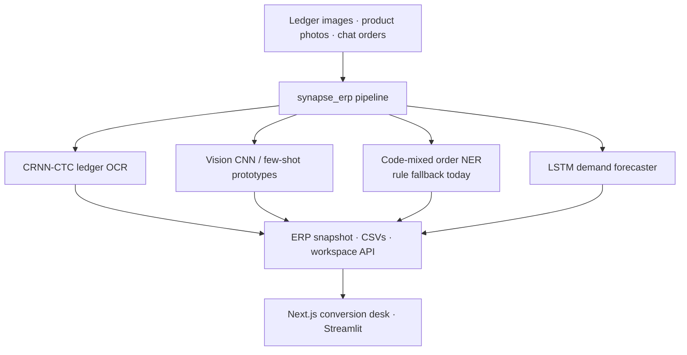

<div align="center">

# Project Synapse ERP

### Multimodal DL + OCR pipeline that turns offline MSME records into a digital ERP

*Handwritten ledger lines · product photos · WhatsApp-style orders → inventory, CRM, invoices, demand forecast.*


</div>

> Full platform docs: [`docs/PROJECT_DOCUMENTATION.md`](docs/PROJECT_DOCUMENTATION.md). This README leads with **measured** metrics from this branch.

---

## Problem

Indian MSMEs keep business data in notebooks, shelf photos, and chat. Typing it into bookkeeping apps is the adoption barrier. Synapse ERP attacks the DL problem: convert messy offline records into structured business objects.

## Architecture



**Design decisions / trade-offs**

| Decision | Why | Trade-off |
|---|---|---|
| Synthetic ledger lines for OCR training | No private shop data required; reproducible CER/WER | Domain gap vs real handwriting — labelled as synthetic |
| LSTM vs moving-average on same split | Honest baseline comparison | Short synthetic series → R² can be negative |
| Metrics only when code actually ran | No invented “target” numbers | Some modules stay TBD until trained |
| CI workflow under `ci/` not `.github/workflows/` | OAuth token lacks `workflow` scope | Copy template to enable Actions |

---

## Results (measured on this branch)

| Module | Metric | Value | How measured |
|---|---|---|---|
| Ledger OCR (CRNN-CTC) | CER / WER / CTC loss | **0.974 / 5.22 / 3.78** | Short CPU run: 3 epochs × ~192 synthetic lines (H=32×W=256, hidden=48); greedy decode on 32 holdout lines. See note below. |
| Demand forecast (synthetic sugar SKU) | LSTM MAE / MAPE | **0.421 / 21.4%** | `train_forecaster.py --source synthetic --epochs 12 --days 220` |
| Demand forecast baseline | Moving-average MAE / MAPE | 0.461 / 22.0% | Same test split |
| Demand forecast | LSTM vs MA | LSTM lower MAE/MAPE | Both R² negative on this short series (honest) |
| Real FX forecast | — | **TBD** | Frankfurter/ECB HTTP 403 here |
| Vision CNN (MNIST) | Test accuracy | **TBD** | Skipped under memory pressure; script: `src/train_vision.py` |
| Order NER / product few-shot | — | **TBD** | Scaffolds only |

**OCR note.** CER ≈ 0.97 after a deliberately tiny CPU run means the model has not learned to read yet — expected. The harness (train → greedy decode → CER/WER) is what this PR ships; re-run with `--epochs 20 --samples 2048` (or real handwriting) and replace [`eval/published/ledger_ocr_metrics.json`](eval/published/ledger_ocr_metrics.json). Do not treat 0.97 as a product claim.

Raw JSON: [`eval/published/summary.json`](eval/published/summary.json).

Reproduce:

```bash
PYTHONPATH=src python src/train_forecaster.py --source synthetic --epochs 12 --days 220
PYTHONPATH=src python src/train_ledger_ocr.py --epochs 5 --samples 256   # includes CER/WER
# or the short CPU harness used for the published OCR numbers:
# python /path/to/short_ocr.py  (logic mirrored in train_ledger_ocr._evaluate_cer_wer)
```

---

## Quickstart

```bash
python -m venv .venv && source .venv/bin/activate
pip install -r requirements.txt && pip install -e .
PYTHONPATH=src python scripts/run_demo.py

# API
PYTHONPATH=src uvicorn synapse_erp.api:app --host 127.0.0.1 --port 8000

# Frontend
cd frontend && npm install && npm run dev
```

### Tests & CI

```bash
pytest -q
```

Workflow template: [`ci/github-actions.yml`](ci/github-actions.yml) — copy to `.github/workflows/ci.yml` on `main`.

---

## Module status

| Course / system part | Status |
|---|---|
| Ledger OCR (CRNN-CTC) | Trained scaffold + **measured** CER/WER harness |
| Demand forecasting (LSTM) | **Measured** vs moving-average on synthetic series |
| Vision encoder (MNIST) | Training script ready; full remasure TBD |
| Order NER | Rule fallback; MuRIL plan TBD |
| Product recognition | Prototype scaffold TBD |
| ERP / workspace API | Implemented (see docs) |

---

## Tech stack

PyTorch · FastAPI · Next.js · Streamlit · scikit-learn · pytest

## License

See repository.
