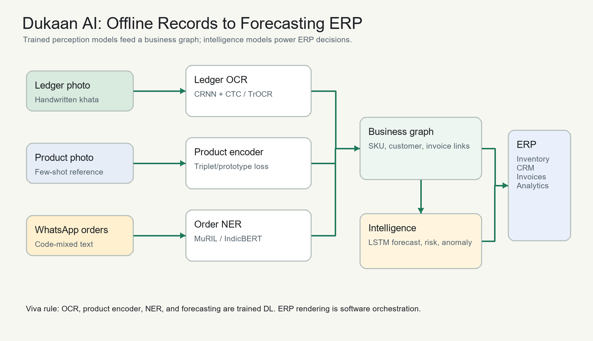

# Project Synapse ERP

Project Synapse ERP is a multimodal deep learning and OCR pipeline for digitizing offline Indian MSMEs. It ingests the records a small shop already has - handwritten khata ledger lines, product photos, and WhatsApp-style orders - and converts them into structured inventory, customer CRM, invoices, and analytics.

## Problem Statement

Many MSMEs already have business data, but it is trapped in notebooks, shelf photos, and informal chats. Existing bookkeeping apps still require manual typing, which is the main adoption barrier for owners with little technical skill. This project focuses on the deep-learning problem of converting messy offline records into structured business data.

## Deep Learning Thesis

| System part | Role | Is it trained DL? | Project status |
| --- | --- | --- | --- |
| Handwritten ledger OCR | Reads ledger line images into date, item, quantity, amount | Yes - CRNN + CTC baseline, TrOCR fine-tuning plan | Implemented architecture and training scaffold |
| Few-shot product recognition | Maps 1-2 product photos to canonical SKU prototypes | Yes - metric learning with triplet/prototypical inference | Implemented model scaffold |
| Code-mixed order NER | Extracts product, quantity, unit, price, customer from Hinglish/Tanglish chats | Yes - MuRIL/IndicBERT token classifier plan | Implemented model scaffold and rule fallback |
| ERP generator | Builds inventory, CRM, invoice, analytics views | No - software orchestration over extracted records | Implemented static ERP renderer |
| Demand forecasting | Predicts next-week SKU demand | Yes - LSTM baseline, N-BEATS/TFT roadmap | Implemented training script |

The viva test used here: every claimed DL contribution must update weights against a labeled loss on a dataset. The first deep implementation focus is OCR plus demand forecasting, matching the project scope guard.

## Repository Layout

```text
.
|-- app/                         # Streamlit demo app
|-- assets/                      # Demo screenshots or GIFs
|-- assets/demo/                 # Demo handwritten-note and product-photo images
|-- data/                        # Demo data and local generated data
|-- docs/                        # Architecture and report assets
|-- frontend/                    # Next.js startup-grade web platform
|-- models/                      # Saved model weights after training
|-- notebooks/                   # EDA and evaluation notebooks
|-- scripts/                     # Utility/demo scripts
|-- src/
|   |-- synapse_erp/               # Main package
|   |-- model.py                 # Rubric-friendly model exports
|   |-- preprocess.py            # Rubric-friendly preprocessing entry
|   |-- predict.py               # Demo prediction entry
|   |-- train_forecaster.py      # LSTM demand training
|   `-- train_ledger_ocr.py      # CRNN-CTC OCR training
|-- PROPOSAL.md
|-- LITERATURE_SURVEY.md
`-- requirements.txt
```

## Startup Platform

The startup-ready platform uses a Next.js frontend with a FastAPI conversion backend.

| Surface | Route / Output | Purpose |
| --- | --- | --- |
| Next.js landing + conversion desk | `http://127.0.0.1:3000` | Upload handwritten-note images, product photos, OCR assist text, and WhatsApp orders |
| FastAPI fallback UI | `http://127.0.0.1:8000` | Backend-hosted conversion desk |
| Service node registry | `/api/services` | Shows OCR, product vision, NER, graph, forecast, ERP, and export nodes |
| Conversion endpoint | `/api/convert` | Runs one conversion job from uploaded files and text |
| Demo conversion | `/api/demo-conversion` | Runs the pipeline with local demo images and sample orders |
| Live market data | `/api/live` | Real-time FX (Frankfurter/ECB) + crypto (CoinGecko) snapshot, cached |
| History series | `/api/live/history` | Real daily FX history for charts and training |
| Train forecaster | `/api/train/forecaster` | Trains the LSTM on REAL USD/INR data (or synthetic) |
| Train vision | `/api/train/vision` | Trains the CNN on the REAL MNIST handwritten-digit dataset |
| Model registry | `/api/models` | Lists trained artifacts and last metrics |
| Generated artifacts | `outputs/conversions/<id>/` | Stores ERP HTML, JSON, CSVs, and report |
| Demo auth | `/api/auth/login` | Returns a local bearer token for the generated workspace |
| Generated workspace | `/api/workspaces/<id>` | Authenticated CRUD workspace for inventory, customers, and invoices |

Run the backend:

```powershell
$env:PYTHONPATH="src"
python -m uvicorn synapse_erp.api:app --host 127.0.0.1 --port 8000
```

Run the frontend in another terminal:

```powershell
cd frontend
npm install
npm run dev
```

Open `http://127.0.0.1:3000`.

The frontend is now a page-by-page flow instead of one long SPA:

| Page | Route | Purpose |
| --- | --- | --- |
| Landing | `/` | Full first interface with product pitch and start button |
| Step 1 | `/step-1` | Upload handwritten notes, product photos, OCR assist text, and chat orders |
| Step 2 | `/step-2` | Show backend conversion nodes and service status |
| Step 3 | `/step-3` | Show generated ERP inside a browser-style viewer |
| Step 4 | `/step-4` | Authenticated CRUD workspace for inventory, customers, and invoices |
| Final | `/final` | Downloads, summary, and future development roadmap |

Each conversion produces:

| File | Format | Meaning |
| --- | --- | --- |
| `snapshot.json` | JSON | Canonical business object for APIs |
| `inventory.csv` | CSV | SKU inventory, revenue, and restock hints |
| `customers.csv` | CSV | CRM-ready customer profiles |
| `invoices.csv` | CSV | Invoice rows created from chat orders |
| `product_catalog.csv` | CSV | Product-photo enrollment results |
| `conversion_report.md` | Markdown | Backend node report and summary |
| `erp/index.html` | HTML | Browser-ready ERP dashboard |

The generated `erp/index.html` is now a self-contained ERP application, not a static report. It includes demo login, inventory/customer/invoice CRUD, searchable tables, live analytics, local persistence, and JSON/CSV exports. See [docs/GENERATED_ERP_CRUD.md](docs/GENERATED_ERP_CRUD.md).

Beyond exported files, each conversion now opens as an authenticated workspace:

- Demo login: `shop_id=synapse-demo`, `pin=1234`
- CRUD resources: `inventory`, `customers`, `invoices`
- API pattern: `/api/workspaces/<conversion_id>/<resource>`
- Frontend behavior: the generated ERP HTML is embedded in a browser-style viewer, while the live workspace rows can be added, edited, and deleted.

See [docs/AUTH_CRUD_API.md](docs/AUTH_CRUD_API.md) for the protected workspace API and [docs/FUTURE_DEVELOPMENT_PLAN.md](docs/FUTURE_DEVELOPMENT_PLAN.md) for the roadmap from proof of concept to real SaaS MVP.

## Architecture



If the PNG is missing, regenerate it:

```powershell
python scripts/make_architecture_diagram.py
```

## Quickstart

```powershell
python -m venv .venv
.\.venv\Scripts\Activate.ps1
python -m pip install -r requirements.txt
python -m pip install -e .
python scripts/run_demo.py
```

The demo writes a static ERP dashboard to `outputs/erp/index.html`.

Run the API:

```powershell
uvicorn synapse_erp.api:app --reload
```

Run the optional Streamlit UI:

```powershell
streamlit run app/streamlit_app.py
```

Train the deep modules. By default the forecaster now trains on **real** data
(5 years of daily USD/INR rates from the Frankfurter / ECB API); pass
`--source synthetic` to use the deterministic SKU demand curves:

```powershell
python src/train_ledger_ocr.py --epochs 3 --samples 256
python src/train_forecaster.py --source real --epochs 12 --years 5
python src/train_vision.py --epochs 3
```

You can also trigger training live from the web UI at `http://127.0.0.1:3000/live`,
which calls `/api/train/forecaster` and `/api/train/vision` and shows the real
loss curves and metrics.

## Data Sources

The current repository includes a deterministic synthetic data generator so the pipeline can run without private shop data. The intended training sources are:

| Modality | Dataset plan | Notes |
| --- | --- | --- |
| Handwritten ledgers | IIIT-HW and synthetic ledger-line images | Fine-tune CRNN/TrOCR on Indic handwriting and ledger-style numeric fields |
| WhatsApp orders | Synthetic code-mixed order corpus, then consented merchant chats | BIO tags: PRODUCT, QUANTITY, UNIT, PRICE, CUSTOMER |
| Product photos | Few-shot product reference photos from local shop shelves | Metric learning with open-set rejection |
| Demand forecasting | Generated transaction history, later real POS/ledger transactions | Metrics: MAE, RMSE, MAPE, R2 |

## Current Results Table

| Module | Metric | Current baseline | Target for final report |
| --- | --- | ---: | ---: |
| Ledger OCR | Character error rate | Trained on synthetic ledger lines (CTC loss) | Lower than Tesseract baseline on ledger lines |
| Order NER | Token F1 | Rule fallback only | MuRIL/IndicBERT fine-tuned F1 |
| Product recognition | Top-1 accuracy | Prototype scaffold | Few-shot prototype accuracy with unknown rejection |
| Vision encoder | Test accuracy | **98.3% on real MNIST** (`train_vision.py`) | Adapt to ledger glyphs |
| Demand forecasting | MAE/RMSE/MAPE/R2 | Trained on **real** USD/INR series (`--source real`) | Beat moving-average baseline |

### Real-time data and real training

Synapse ERP no longer runs on mocked numbers for its intelligence layer:

- **Live market feed** — `/api/live` streams real FX rates (Frankfurter / ECB)
  and crypto spot prices (CoinGecko) into the dashboard. The web UI at
  `/live` polls it every 15 seconds and also renders a real historical
  USD/INR chart.
- **Real DL training** — the LSTM forecaster downloads real daily FX history
  and the CNN vision encoder trains on the real 60k-image MNIST dataset. Both
  update weights against a labeled loss and persist real metrics + loss curves
  under `outputs/metrics` and `outputs/figures`.
- **UI/UX** — the frontend was rebuilt with a premium SaaS-admin aesthetic
  (inspired by free templates such as TailAdmin, Aceternity UI, and SaaSFast):
  glass panels, gradient accents, live stat cards, SVG charts, and a dedicated
  Live Market Intelligence + Training console.

## Module Mapping

| Course module | Project use |
| --- | --- |
| M1 - RNN/LSTM | BiLSTM sequence modeling in OCR; LSTM demand forecasting |
| M2 - CNN/Attention/Transfer Learning/Autoencoder | CNN visual encoder for OCR/product photos; TrOCR/Transformer roadmap; anomaly autoencoder roadmap |
| M3 - Deployment and real-world relevance | FastAPI/Streamlit deployment, free-tier scope, MSME digitization impact |

See [docs/MODULE_MAPPING.md](docs/MODULE_MAPPING.md) for the fuller viva mapping.

## References

1. Shi, Bai, and Yao, "An End-to-End Trainable Neural Network for Image-based Sequence Recognition and Its Application to Scene Text Recognition," arXiv, 2015. https://arxiv.org/abs/1507.05717
2. Li et al., "TrOCR: Transformer-based Optical Character Recognition with Pre-trained Models," arXiv, 2021. https://arxiv.org/abs/2109.10282
3. Khanuja et al., "MuRIL: Multilingual Representations for Indian Languages," arXiv, 2021. https://arxiv.org/abs/2103.10730
4. Snell, Swersky, and Zemel, "Prototypical Networks for Few-shot Learning," arXiv, 2017. https://arxiv.org/abs/1703.05175
5. Oreshkin et al., "N-BEATS: Neural basis expansion analysis for interpretable time series forecasting," arXiv, 2019. https://arxiv.org/abs/1905.10437
6. Lim et al., "Temporal Fusion Transformers for Interpretable Multi-horizon Time Series Forecasting," arXiv, 2019. https://arxiv.org/abs/1912.09363
