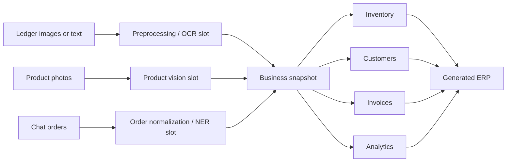

# Synapse ERP Project Documentation

## 1. Overview

Synapse ERP is a multimodal deep-learning and OCR proof of concept for digitizing records held by Indian micro, small, and medium businesses. It accepts handwritten ledger records, product photographs, and informal WhatsApp-style orders, then converts them into structured business data:

- inventory and SKU summaries
- customer profiles
- invoice rows
- revenue and order analytics
- forecast and anomaly messages
- a browser-ready ERP dashboard
- JSON, CSV, Markdown, and HTML export artifacts

The repository contains two user interfaces:

1. A Next.js startup-style frontend in `frontend/`.
2. A FastAPI-hosted conversion desk and generated ERP renderer in `src/synapse_erp/`.

The primary data path is:



The deterministic parser and synthetic data fallback make the demo runnable without private merchant data. Trainable model architectures and training scripts are included as the deep-learning extension points.

## 2. Repository Map

| Path | Responsibility |
| --- | --- |
| `app/streamlit_app.py` | Optional Streamlit interface |
| `assets/demo/` | Demo ledger and product images used by `/api/demo-conversion` |
| `data/` | Demo and local data files |
| `docs/` | Architecture diagrams and project documentation |
| `frontend/` | Next.js web application |
| `models/` | Saved PyTorch model checkpoints |
| `notebooks/` | Exploratory analysis and evaluation notebooks |
| `outputs/` | Generated conversions, datasets, metrics, figures, caches, uploads, and workspaces |
| `scripts/run_demo.py` | Runs the offline pipeline and renders an ERP HTML file |
| `scripts/make_demo_assets.py` | Generates demo assets |
| `scripts/make_architecture_diagram.py` | Builds the architecture PNG from the Mermaid source |
| `scripts/generate_report_pdf.py` | Generates a report PDF from project outputs |
| `src/synapse_erp/` | Main Python package |
| `src/model.py` | Compatibility export for model classes |
| `src/preprocess.py` | Compatibility export for preprocessing helpers |
| `src/predict.py` | Compact offline demo entry point |
| `src/train_ledger_ocr.py` | CRNN + CTC training script |
| `src/train_forecaster.py` | LSTM forecasting training script |
| `src/train_vision.py` | CNN training script on MNIST |
| `pyproject.toml` | Python packaging and pytest configuration |
| `requirements.txt` | Runtime and training dependencies |

## 3. System Components

### 3.1 Configuration

[src/synapse_erp/config.py](../src/synapse_erp/config.py) defines project-wide paths and defaults:

- `PROJECT_ROOT`: repository root
- `DATA_DIR`: `data/`
- `MODEL_DIR`: `models/`
- `OUTPUT_DIR`: `outputs/`
- random seed: `42`
- default currency: INR
- default forecast horizon: 7 days

### 3.2 Preprocessing and normalization

[src/synapse_erp/preprocess.py](../src/synapse_erp/preprocess.py) is the deterministic bridge between extracted text and business fields. It:

- lowercases and cleans informal text
- maps aliases such as `chini`, `chawal`, `atta`, `dal`, and `tel` to canonical SKUs
- normalizes units such as `kgs`, `gm`, `ltr`, and `pcs`
- normalizes common date formats to `YYYY-MM-DD`
- extracts quantity and unit values
- estimates amounts from the local price book when no amount is present
- parses ledger lines into `LedgerRecord`
- parses chat orders into `OrderIntent`

The current default catalog includes sugar, rice, wheat flour, toor dal, tea, Parle-G, and cooking oil.

### 3.3 Pipeline and business graph

[src/synapse_erp/pipeline.py](../src/synapse_erp/pipeline.py) contains two central classes:

- `SynapseERPPipeline`: accepts ledger lines and chat lines, parses them, and delegates aggregation.
- `BusinessKnowledgeGraph`: combines ledger records and orders by SKU and customer, creates invoices for chat orders, and calculates analytics.

The graph is currently an in-memory aggregation layer rather than a persistent graph database. Its outputs include:

- revenue and quantity totals by SKU
- customer order and revenue totals
- reorder hints based on quantity sold
- simple customer risk buckets
- a top-SKU forecast message
- a high-value ledger anomaly message

### 3.4 Startup conversion service

[src/synapse_erp/platform.py](../src/synapse_erp/platform.py) owns the upload-oriented workflow used by the web platform. It creates a conversion directory, profiles uploaded images, runs the pipeline, renders the ERP, and writes export files.

The service catalog contains these nodes:

1. Upload Gateway
2. Image Preprocessor
3. Ledger OCR Node
4. Product Vision Node
5. Order NER Node
6. Business Graph Node
7. Forecast Node
8. ERP Builder Node
9. Export Node

The current OCR, product recognition, and NER nodes expose deterministic fallback behavior. They are structured so trained models can replace those slots.

### 3.5 ERP renderer

[src/synapse_erp/erp.py](../src/synapse_erp/erp.py) renders a generated HTML dashboard from a `BusinessSnapshot`. The conversion service places it at `outputs/conversions/<conversion_id>/erp/index.html`.

### 3.6 Live data

[src/synapse_erp/live_data.py](../src/synapse_erp/live_data.py) retrieves and caches:

- fiat FX rates from Frankfurter / ECB
- historical FX series from Frankfurter / ECB
- cryptocurrency prices from CoinGecko
- gold and silver prices from gold-api.com

Data is cached in memory and under `outputs/live_cache/`. When a live request fails, the last cached value is used where available.

## 4. Data Model

The shared records are defined in [src/synapse_erp/schema.py](../src/synapse_erp/schema.py).

### `LedgerRecord`

| Field | Type | Meaning |
| --- | --- | --- |
| `date` | string | Normalized transaction date |
| `item` | string | Canonical SKU |
| `quantity` | float | Quantity sold |
| `unit` | string | `kg`, `g`, `l`, `pack`, `pcs`, or another normalized unit |
| `amount` | float | Transaction amount |
| `customer` | string | Customer name or `walk-in` |
| `source` | string | Defaults to `ledger` |

### `OrderIntent`

Represents an order extracted from chat. It contains the customer, canonical SKU, quantity, unit, original text, and `whatsapp` source marker.

### `BusinessSnapshot`

The canonical output object contains:

- `inventory`: list of `InventoryItem`
- `customers`: list of `CustomerProfile`
- `invoices`: list of `Invoice`
- `analytics`: optional `AnalyticsSummary`
- `source_records`: parsed ledger records
- `source_orders`: parsed chat orders

`BusinessSnapshot.to_dict()` converts the dataclasses into JSON-compatible dictionaries.

## 5. Local Setup

### Requirements

- Windows PowerShell or another shell
- Python 3.10 or newer
- Node.js and npm for the Next.js frontend
- Network access for live FX, crypto, commodity feeds, real-data forecasting, and first-time model downloads

### Python environment

```powershell
python -m venv .venv
.\.venv\Scripts\Activate.ps1
python -m pip install -r requirements.txt
python -m pip install -e .
```

### Run the offline demo

```powershell
python scripts/run_demo.py
```

This runs the synthetic-data pipeline and prints a JSON summary. It writes a generated dashboard under `outputs/erp/index.html`.

### Run the FastAPI backend

From the repository root:

```powershell
$env:PYTHONPATH="src"
python -m uvicorn synapse_erp.api:app --host 127.0.0.1 --port 8000
```

The backend is available at `http://127.0.0.1:8000`. The root endpoint serves a small backend-hosted conversion UI, while `/docs` is FastAPI's generated OpenAPI interface.

### Run the Next.js frontend

In a second terminal:

```powershell
cd frontend
npm install
npm run dev
```

Open `http://127.0.0.1:3000`.

The frontend can use another backend by setting `NEXT_PUBLIC_API_BASE` before starting Next.js.

### Run Streamlit

```powershell
streamlit run app/streamlit_app.py
```

### Generate the architecture image

```powershell
python scripts/make_architecture_diagram.py
```

## 6. Conversion Workflow

### Inputs

`POST /api/convert` accepts multipart form data:

| Field | Type | Meaning |
| --- | --- | --- |
| `ledger_images` | files | Handwritten ledger images |
| `product_images` | files | Product reference images |
| `ledger_text` | text | Optional OCR-assist or manually corrected ledger lines |
| `chat_text` | text | One chat/order per line |
| `product_hints` | text | Product labels, one per line or comma-separated |

### Processing stages

1. Uploaded files are copied into `outputs/uploads/<conversion_id>/` with sanitized unique names.
2. Images are profiled with Pillow when available; dimensions, color mode, checksum, and brightness signal are recorded.
3. Ledger text is accepted as an explicit operator transcription. Otherwise, uploaded images run through the installed CRNN checkpoint; unreadable results fail with a corrective message instead of generated rows.
4. Product hints are recorded as operator labels. Filename-derived labels are marked for review, and no confidence score is invented.
5. Chat lines are normalized and passed to the deterministic order parser.
6. Ledger and order records are aggregated into a `BusinessSnapshot`.
7. The ERP HTML dashboard is generated.
8. JSON, CSV, Markdown, and HTML output artifacts are written.
9. A `conversion_result.json` file records nodes, assets, extracted lines, normalized orders, snapshot, and output URLs.
10. A workspace is initialized from the snapshot for authenticated CRUD access.

### Observed background conversion

`POST /api/conversions` accepts the same multipart input and immediately returns a job ID. `GET /api/conversions/{job_id}` exposes current state, measured node durations, timestamped events, failure details, and the completed result.

## 7. Generated Outputs

For a conversion ID such as `conv-20260805155033-66779b`, outputs are stored under `outputs/conversions/<conversion_id>/`:

| File | Purpose |
| --- | --- |
| `conversion_result.json` | Full conversion response persisted on disk |
| `snapshot.json` | Canonical `BusinessSnapshot` data |
| `inventory.csv` | Inventory rows, revenue, and reorder hints |
| `customers.csv` | Customer CRM rows |
| `invoices.csv` | Invoice rows generated from chat orders |
| `product_catalog.csv` | Product-photo enrollment candidates |
| `conversion_report.md` | Human-readable conversion summary and node report |
| `erp/index.html` | Self-contained generated ERP dashboard |

Other output locations:

| Path | Contents |
| --- | --- |
| `outputs/models` | Not used by the current config; checkpoints are saved in root `models/` |
| `outputs/metrics` | JSON metrics from training jobs |
| `outputs/figures` | Training loss plots |
| `outputs/datasets/MNIST` | Downloaded MNIST data |
| `outputs/live_cache` | Cached market and history responses |
| `outputs/uploads` | Uploaded or copied conversion assets |
| `outputs/workspaces` | JSON-backed editable workspaces |
| `outputs/logs` | Durable JSONL runtime events grouped by UTC date |

## 8. FastAPI API Reference

### Health and platform

| Method | Route | Purpose |
| --- | --- | --- |
| `GET` | `/` | Backend-hosted conversion UI |
| `GET` | `/health` | Returns `{ "status": "ok" }` |
| `GET` | `/api/services` | Lists conversion service nodes and status metadata |
| `GET` | `/api/observability` | Returns request benchmarks, job counts, data sources, and recent events |
| `GET` | `/generated/{path}` | Serves generated output files |
| `GET` | `/project-assets/{path}` | Serves files from `docs/` |

### Conversion and legacy pipeline routes

| Method | Route | Purpose |
| --- | --- | --- |
| `POST` | `/api/convert` | Runs a file/text conversion job |
| `POST` | `/api/conversions` | Queues a conversion over submitted records |
| `GET` | `/api/conversions/{job_id}` | Returns live job progress and the completed result |
| `POST` | `/ingest` | Parses supplied `ledger_lines` and `chat_lines` JSON |
| `GET` | `/demo` | Retired with HTTP 410 to prevent synthetic runtime data |
| `GET` | `/erp` | Retired with HTTP 410; ERP output requires submitted records |

`POST /ingest` accepts JSON with optional arrays named `ledger_lines` and `chat_lines`.

### Market data

| Method | Route | Purpose |
| --- | --- | --- |
| `GET` | `/api/live` | Combined FX, crypto, and commodity snapshot |
| `GET` | `/api/live/history` | Historical FX series; accepts `base`, `symbol`, and `years` |

### Models and training

| Method | Route | Purpose |
| --- | --- | --- |
| `GET` | `/api/models` | Lists metric JSON files and loss-curve URLs |
| `POST` | `/api/train/forecaster` | Trains the LSTM forecaster; accepts source and hyperparameters |
| `POST` | `/api/train/vision` | Trains the MNIST CNN; accepts epochs, batch size, and learning rate |
| `GET` | `/api/inference/vision/random` | Predicts a random MNIST test image |
| `POST` | `/api/inference/vision` | Classifies a flat 784-value grayscale image |
| `POST` | `/api/inference/forecast` | Predicts the next value from a recent numeric series |
| `GET` | `/api/inference/pretrained-models` | Lists lazy-loaded Hugging Face models |
| `POST` | `/api/inference/ocr` | Runs TrOCR on a base64 image |
| `POST` | `/api/inference/ner` | Runs BERT token classification on text |

The current pre-trained registry uses `microsoft/trocr-base-handwritten` for OCR and `dslim/bert-base-NER` for token classification. The models are loaded lazily on first request.

### Workspace CRUD

Workspace routes require an `Authorization: Bearer <token>` header.

| Method | Route | Purpose |
| --- | --- | --- |
| `GET` | `/api/workspaces/{conversion_id}` | Returns the full workspace |
| `GET` | `/api/workspaces/{conversion_id}/{resource}` | Lists `inventory`, `customers`, or `invoices` |
| `POST` | `/api/workspaces/{conversion_id}/{resource}` | Adds a row; the resource key is required |
| `PATCH` | `/api/workspaces/{conversion_id}/{resource}/{item_id}` | Updates a row |
| `DELETE` | `/api/workspaces/{conversion_id}/{resource}/{item_id}` | Deletes a row |

The JSON-backed store initializes a workspace from `snapshot.json` and writes to `outputs/workspaces/<conversion_id>/workspace.json`. A conversion-scoped bearer token is returned once in the conversion result; only its SHA-256 hash is stored in `access.json`.

## 9. Frontend Routes

The Next.js App Router pages are under `frontend/app/`:

| Route | Purpose |
| --- | --- |
| `/` | Landing page and entry point |
| `/step-1` | Upload ledger images, product images, OCR text, and chat text |
| `/step-2` | Displays backend conversion nodes and service status |
| `/step-3` | Displays the generated ERP in a browser-style viewer |
| `/step-4` | Authenticated inventory, customer, and invoice workspace |
| `/live` | Live market data, historical chart, model training and inference console |
| `/models` | Model registry and metrics view |
| `/final` | Downloads, summary, and roadmap |

`frontend/app/lib/flow.js` stores conversion, workspace, and auth responses in browser `localStorage`. The API base defaults to `http://127.0.0.1:8000` and can be overridden with `NEXT_PUBLIC_API_BASE`.

## 10. Deep-Learning Modules

The public model exports are collected in [src/synapse_erp/models/__init__.py](../src/synapse_erp/models/__init__.py) and re-exported by [src/model.py](../src/model.py).

| Module | Architecture | Current role |
| --- | --- | --- |
| Ledger OCR | `LedgerCRNN`, `TrOCR` | CRNN-CTC baseline and transformer OCR slot |
| Product recognition | `ProductEmbeddingNet` | Few-shot embedding/prototype matching scaffold |
| Order NER | `MuRILTokenClassifier`, `BiLSTM_CRF` | Code-mixed entity extraction scaffold |
| Forecasting | `LSTMDemandForecaster`, `TemporalFusionTransformer` | LSTM baseline and roadmap architecture |
| Anomaly detection | `LedgerAnomalyAE` | Autoencoder scaffold |
| Graph intelligence | `BusinessGraphSAGE` | Graph model scaffold |

### OCR training

```powershell
python src/train_ledger_ocr.py --epochs 3 --samples 256
```

The script generates synthetic ledger-line images, trains a CRNN with CTC loss, saves `models/best_ledger_ocr.pt`, writes `outputs/metrics/ledger_ocr_metrics.json`, and plots `outputs/figures/ledger_ocr_loss.png`.

### Forecast training

```powershell
python src/train_forecaster.py --source real --epochs 12 --years 5
```

Use `--source synthetic` for deterministic SKU demand curves. Real mode downloads daily USD/INR history, standardizes it, trains an LSTM with MSE loss, compares it with a moving-average baseline, and saves `models/best_forecaster.pt` and `models/best_model.pt`.

### Vision training

```powershell
python src/train_vision.py --epochs 3
```

This downloads MNIST, trains a CNN with cross-entropy loss, evaluates on the test set, saves `models/best_vision_cnn.pt`, and writes metrics and a loss curve.

The MNIST model is a perception proof of concept, not a trained ledger OCR model. Adapting it to ledger glyphs requires a domain-specific labeled dataset.

## 11. Data Sources and Reproducibility

### Synthetic sources

[src/synapse_erp/data/synthetic.py](../src/synapse_erp/data/synthetic.py) supplies deterministic demo ledger lines, chat orders, and SKU demand curves. The project seed is `42`.

### External sources

- Frankfurter / ECB: fiat rates and historical FX
- CoinGecko: cryptocurrency spot prices
- gold-api.com: gold and silver spot prices
- MNIST: handwritten digit training and test data
- Hugging Face model hub: lazy-loaded TrOCR and BERT checkpoints

Network-backed functions cache successful responses. A first run may therefore take longer and may require internet access. A cache fallback is available for many market-data requests, but a missing model checkpoint still requires training or download.

## 12. Security and Persistence Notes

This repository is a local demonstration, not a production SaaS deployment.

- Workspace access uses a random conversion-scoped bearer token whose hash is persisted server-side.
- Workspaces are JSON files, not tenant-isolated database records.
- Uploads are stored on the local filesystem.
- CORS allows a small set of localhost origins.
- There is no production user management, password hashing, refresh-token flow, rate limiting, malware scanning, or object-storage integration.
- The generated ERP uses local persistence for some browser interactions.

Use managed identity, tenant isolation, token rotation, and a database before a production deployment.

## 13. Known Gaps and Maintenance Notes

These are implementation facts that should be resolved before presenting the project as a production system:

1. Workspaces remain JSON-backed local files rather than tenant-isolated database records.
2. The active order extraction is deterministic; the optional BERT endpoint is separate and is not presented as the conversion parser.
3. Forecast and anomaly messages in the business snapshot are transparent heuristics. They remain separate from trained forecasting inference.
4. The local OCR checkpoint was trained on synthetic ledger-line images; its benchmark provenance is visible and it should be fine-tuned on consented shop data before production.
5. Product photos are cataloged from operator or filename labels. A trained product-embedding model is not yet wired into the active conversion.

## 14. Suggested Validation Checklist

```powershell
# Python import and offline pipeline
$env:PYTHONPATH="src"
python -m compileall src
python scripts/run_demo.py

# Backend smoke checks, with the API running in another terminal
Invoke-RestMethod http://127.0.0.1:8000/health
Invoke-RestMethod http://127.0.0.1:8000/api/services
Invoke-RestMethod -Method Post http://127.0.0.1:8000/api/demo-conversion

# Frontend production check
cd frontend
npm run build
```

A successful demo should create a structured snapshot, CSV exports, a Markdown report, an ERP HTML file, and a workspace directory under `outputs/`.

## 15. Related Documentation

- [Project README](../README.md)
- [Architecture source](architecture.mmd)
- The README contains the current course-module mapping; a separate `MODULE_MAPPING.md` file is not present in this checkout.
- [Architecture image](architecture.png)
